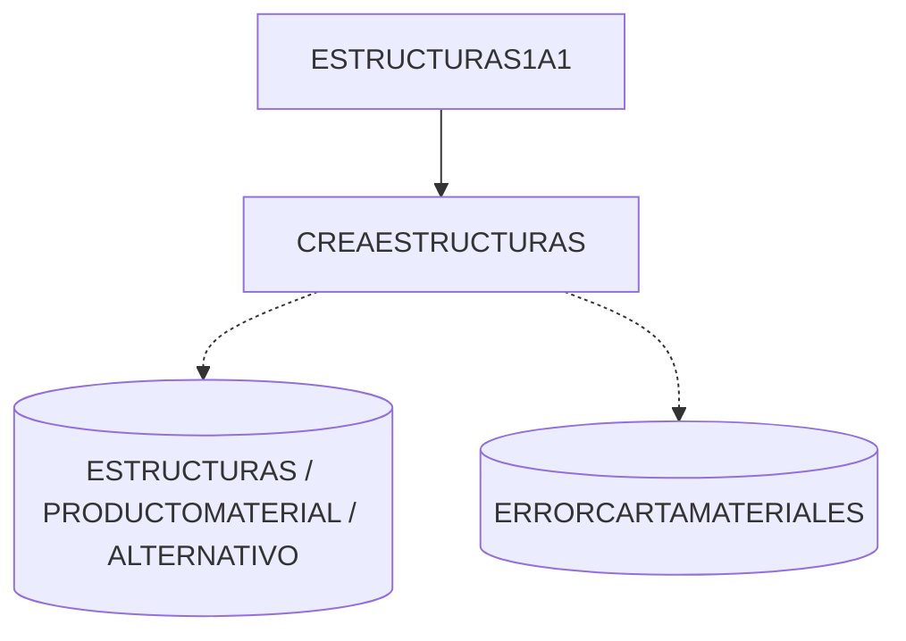

# Grafo de dependencias de stored procedures — v2

**Fecha de verificación LIVE:** 2026-10-22
**Bases auditadas:** `CALE_IMMEX` (114 procedimientos, esquema `dbo`) y `ANEXO24_DEV` (40 procedimientos, esquema `app24`)
**Fuentes:** `sys.sql_expression_dependencies`, `sys.sql_modules` (análisis estático de `EXEC`), `sys.procedures`, `sys.objects`, `sys.synonyms`, `sys.triggers`, `sys.servers`, `sys.databases`
**Documento maestro:** [auditoria-forense-sp-reutilizacion-v2.md](auditoria-forense-sp-reutilizacion-v2.md) · **Inventario:** [inventario-sp-reutilizacion-v2.csv](inventario-sp-reutilizacion-v2.csv)

> Nota metodológica: las aristas se reconstruyeron combinando `sys.sql_expression_dependencies` (referencias resueltas por el motor) con extracción estática de `EXEC/EXECUTE` sobre `sys.sql_modules.definition`. No se ejecutó ningún procedimiento.

---

## 1. Convenciones

| Marca | Significado |
|---|---|
| `A --> B` | `A` invoca `B` mediante `EXEC` (CONFIRMADO por definición) |
| `A -.-> B` | Referencia de objeto sin `EXEC` (tabla/vista/función) |
| `A ==> B` | Dependencia entre bases de datos (nombre de 3 partes) |
| `NO_RESUELTO` | El objeto destino no existe en `sys.objects` de la base actual (CONFIRMADO por consulta) |

---

## 2. Grafo por familias

### 2.1 Descargos / PEPS (núcleo fiscal)

```mermaid
graph TD
    DS[DESCARGATSALIDA<br/>sin params] --> DS1[DESCARGATSALIDA1]
    DS --> DS2[DESCARGATSALIDA2<br/>NO_RESUELTO]
    DS1 --> DT[DESCARGATODOSDIRIGIDOS]
    DS1 --> SAL[SALDOS]
    DSF[DESCARGATSALIDAFECHA<br/>@HASTA] --> DT
    DSF --> SAL
    DX[DESCARGAXFECHA51<br/>@hasta] --> DT
    DX --> LD[LIGADESPERDICIOS]
    DX --> SAL
    DX --> ADP[aplica_descarga_desp<br/>NO_RESUELTO]
    DT --> DD[DESCDIRIGIDA<br/>@SALIDAKEY @PSALIDAKEY]
    DD --> SD[SALDOSDIRIGIDOS]
    DP[DESCARGASALIDAPEPS<br/>@SALIDAKEY] --> DD
    DP --> SAL
    DI[DESCARGAINICIAL] --> DL[DESCARGASALIDA<br/>NO_RESUELTO]
    SAL -.-> DESCARGA
    SAL -.-> PARTIDAS
    SAL -.-> TRAZO
    SD -.-> DESCARGA
    SD -.-> TRAZO
```

`SALDOS` es la hoja del árbol de descargos: nadie lo invoca salvo los 4 procedimientos de descarga y es el único que aplica PEPS real (ver §4).

### 2.2 Pedimentos / importaciones

```mermaid
graph TD
    AP[APP24_C_PEDIMENTO_CONFIRMAR<br/>@CargaId @UsuarioId @CorrelacionId] ==>|ANEXO24_DEV.app24| ST[(CargaPedimento / CargaPedimentoFila / ErrorCargaPedimento)]
    AP ==>|ANEXO24_DEV.app24| BIT[APP24_C_BITACORA_REGISTRAR]
    AP -.-> IMP[(IMPORTACIONES)]
    AP -.-> PAR[(PARTIDAS)]
    AP -.-> SALI[(SALIDAS)]
    AP -.-> PS[(PSALIDAS)]
    AP -.-> DIR[(DIRIGIDO)]
    IP[INSERTAPEDIMENTO<br/>@ITEM] --> VP[VALIDAPEDIMENTO<br/>@PEDIMENTO]
    VP --> IE[INSERTERROR<br/>@ERROR @PEDIMENTO @TIPO @PARTIDA]
    VP -.-> EV[(ERRORVALIDACION)]
    IA31[INSERTAFALTANTESA31] --> IO[INDICAOPERACION]
    IA31 ==>|DATA_STAGE_CALE| VST[(V_PARTIDAS / V_ENCABEZADO / V_R1 / V_CONTRIBUCIONES_PARTIDA)]
```

`CARGAPEDIMENTOS` (sin parámetros) **no** pertenece a esta cadena: trabaja sobre su propio staging `dbo.CARGAPEDIMENTOSIE` y escribe directamente `IMPORTACIONES/PARTIDAS/SALIDAS/PSALIDAS/DIRIGIDO` sin invocar `VALIDAPEDIMENTO` (CONFIRMADO: 0 aristas salientes).

### 2.3 Compulsa / glosa / Anexo 30

```mermaid
graph TD
    SG6[SP_G6<br/>@ANIO @PERIODO @SUSTITUYE @clave_destino] --> SG6F[SP_G6_F4]
    SG6 --> VVU[VALIDACIONESVU<br/>@DESDE @HASTA @CLAVE]
    VVU ==>|CALE_PVU_FS| PVU[(V_ENCABEZADO / V_PARTIDAS)]
    SG5[SP_G5<br/>@HASTA] --> LD[LIGADESPERDICIOS]
    HDF[HISTORIADESCARGASF<br/>@DESDE @HASTA @CODIGO] --> LD
    HDP[HISTORIADESCARGASP<br/>@DOCUMENTO] --> LD
    PC[PR_COMPULSACANTIDADES<br/>@AÑO @MES @PEDIMENTO] ==>|CALE_PVU_FS| PVP[(V_PARTIDAS)]
    PCA[PR_CompulsaDSA24<br/>@DESDE @HASTA @PEDIMENTOARMADO @TIPO] -.-> VGL[(v_glosa / v_partidas)]
    TG[SP_GENERA_TXT_COMPLETO] -->|xp_cmdshell + bcp| EXT[[sistema de archivos / shell]]
```

### 2.4 Estructuras / catálogos / actas



El resto de los procedimientos de carga de catálogos (`CARGA_PRODUCTOS`, `CARGA_MATERIALES`, `CARGACLIENTES`, `CARGAPROVEEDORES`, `CARGAAgentes`, `CARGA_FACTURAS`, `CARGAACTAS`, `CARGACONSTANCIAS`, `CARGA_ESTRUCTURADESENSAMBLE`, `CARGA_ENCABEZADOS`, `CARGA_SUBMAQUILA`) son **hojas sin parámetros**: no invocan otros SP; consumen tablas de staging `ECARGA*` / `TMP*` / `TFACTURA` y escriben tablas operativas (CONFIRMADO).

---

## 3. Aristas completas (31)

| Origen | Destino | Tipo | Estado |
|---|---|---|---|
| `DESCARGASALIDAPEPS` | `DESCDIRIGIDA` | EXEC | CONFIRMADO |
| `DESCARGASALIDAPEPS` | `SALDOS` | EXEC | CONFIRMADO |
| `DESCDIRIGIDA` | `SALDOSDIRIGIDOS` | EXEC | CONFIRMADO |
| `DESCARGATODOSDIRIGIDOS` | `DESCDIRIGIDA` | EXEC | CONFIRMADO |
| `DESCARGATSALIDA` | `DESCARGATSALIDA1` | EXEC | CONFIRMADO |
| `DESCARGATSALIDA` | `DESCARGATSALIDA2` | EXEC | **NO_RESUELTO** |
| `DESCARGATSALIDA1` | `DESCARGATODOSDIRIGIDOS` | EXEC | CONFIRMADO |
| `DESCARGATSALIDA1` | `SALDOS` | EXEC | CONFIRMADO |
| `DESCARGATSALIDAFECHA` | `DESCARGATODOSDIRIGIDOS` | EXEC | CONFIRMADO |
| `DESCARGATSALIDAFECHA` | `SALDOS` | EXEC | CONFIRMADO |
| `DESCARGAXFECHA51` | `DESCARGATODOSDIRIGIDOS` | EXEC | CONFIRMADO |
| `DESCARGAXFECHA51` | `LIGADESPERDICIOS` | EXEC | CONFIRMADO |
| `DESCARGAXFECHA51` | `SALDOS` | EXEC | CONFIRMADO |
| `DESCARGAXFECHA51` | `aplica_descarga_desp` | EXEC | **NO_RESUELTO** |
| `DESCARGAINICIAL` | `DESCARGASALIDA` | EXEC | **NO_RESUELTO** |
| `DESCARGAS_A31` | `A31_SALDOS` | EXEC | CONFIRMADO |
| `DESCARGASCTM` | `SALDOSCTM` | EXEC | CONFIRMADO |
| `LIGACTMFACTURA` | `SALDOSCTM` | EXEC | CONFIRMADO |
| `HISTORIADESCARGASF` | `LIGADESPERDICIOS` | EXEC | CONFIRMADO |
| `HISTORIADESCARGASP` | `LIGADESPERDICIOS` | EXEC | CONFIRMADO |
| `SP_G5` | `LIGADESPERDICIOS` | EXEC | CONFIRMADO |
| `SP_G6` | `SP_G6_F4` | EXEC | CONFIRMADO |
| `SP_G6` | `VALIDACIONESVU` | EXEC | CONFIRMADO |
| `INSERTAPEDIMENTO` | `VALIDAPEDIMENTO` | EXEC | CONFIRMADO |
| `VALIDAPEDIMENTO` | `INSERTERROR` | EXEC | CONFIRMADO |
| `INSERTAFALTANTESA31` | `INDICAOPERACION` | EXEC | CONFIRMADO |
| `ESTRUCTURAS1A1` | `CREAESTRUCTURAS` | EXEC | CONFIRMADO |
| `HOJATRABAJODESCARGOSA31` | `PROC_HISTORIADESCARGASALIDA` | EXEC | CONFIRMADO |
| `HOJATRABAJOCTMDESPA31` | `PROC_DESCARGASF4CTMA` | EXEC | CONFIRMADO |
| `APP24_C_PEDIMENTO_CONFIRMAR` | `ANEXO24_DEV.app24.APP24_C_BITACORA_REGISTRAR` | EXEC 3 partes | CONFIRMADO |
| `APP24_C_PEDIMENTO_CONFIRMAR` | `sp_getapplock` | EXEC sistema | CONFIRMADO |
| `SP_GENERA_TXT_COMPLETO` | `xp_cmdshell` (+ `bcp`) | EXEC externo | CONFIRMADO |

**Nota:** `APP24_C_PEDIMENTO_CONFIRMAR` ejecuta además `EXEC (...) ... @LockResultado`, que corresponde a `sp_getapplock` y no a un procedimiento de usuario; el extractor lo reporta como destino no resuelto y aquí se clasifica correctamente.

---

## 4. Efectos transitivos por raíz

Si un consumidor invocara una raíz, el efecto efectivo (incluyendo descendientes) es:

| Raíz | Efectos directos | Efectos transitivos | Clasificación efectiva |
|---|---|---|---|
| `DESCARGATSALIDA` | ninguno (sólo `SELECT SETTINGS`) | `DESCARGATSALIDA1` → `DESCARGATODOSDIRIGIDOS`, `SALDOS`; `DESCARGATSALIDA2` inexistente | `UNKNOWN_SIDE_EFFECTS` (objeto destino ausente) |
| `DESCARGATSALIDAFECHA` | `DELETE/INSERT SETTINGS`, `DELETE TRAZO/DESCARGA`, `UPDATE PARTIDAS` | + `DESCDIRIGIDA`/`SALDOSDIRIGIDOS` | `MIXED_CONFIRMED` |
| `DESCARGASALIDAPEPS` | `DELETE TRAZO`, `DELETE DESCARGA`, `UPDATE PARTIDAS`, `INSERT TRAZO` | + `DESCDIRIGIDA` → `SALDOSDIRIGIDOS`; + `SALDOS` → `INSERT DESCARGA`, `UPDATE PARTIDAS`, `INSERT TRAZO` | `MIXED_CONFIRMED` |
| `DESCARGAXFECHA51` | 11 `DELETE`, 18 `INSERT`, 33 `UPDATE` sobre `PARTIDAS/SALIDAS/PSALIDAS/DESCARGA/TRAZO/DIRIGIDO/SETTINGS` | + `LIGADESPERDICIOS`, `SALDOS`, `DESCARGATODOSDIRIGIDOS`, `aplica_descarga_desp` (ausente) | `MIXED_CONFIRMED` + rama no resuelta |
| `SP_GENERA_TXT_COMPLETO` | 15 `UPDATE` sobre `M/P/PM/PS` | `xp_cmdshell` (ejecución de SO) | `EXTERNAL_SIDE_EFFECTS` |
| `SP_G6` | `INSERT G6`, `INSERT SalidasA31Key`, `DELETE G6` | + `SP_G6_F4` (`INSERT G6`, `UPDATE DIRIGIDO`), + `VALIDACIONESVU` (`INSERT VALIDACIONVU`, `UPDATE IMPORTACIONES/SALIDAS`) | `MIXED_CONFIRMED` |
| `INSERTAPEDIMENTO` | 6 `INSERT`, 6 `UPDATE`, 12 `DELETE` sobre tablas operativas | + `VALIDAPEDIMENTO` → `INSERTERROR` → `ERRORVALIDACION` | `MIXED_CONFIRMED` |
| `BLOQUEA_DOCUMENTO` | `UPDATE PSALIDAS`, `INSERT DESCARGOSBLOQUEADOS` | ninguno | `WRITE_CONFIRMED` |
| `PR_INFORME_*`, `PR_CompulsaDSA24`, `NUEVOFOLIOB` | sólo `SELECT` y escrituras en variables de tabla `@res/@temp/@T_*` | ninguno | `READ_ONLY_CONFIRMED` |

Archivo por procedimiento: verificación fila a fila en `inventario-sp-reutilizacion-v2.csv` (columna `clasificacion_seguridad`).

---

## 5. Dependencias no resueltas (hallazgo)

| Objeto invocado | Invocado desde | Evidencia | Consecuencia |
|---|---|---|---|
| `dbo.DESCARGATSALIDA2` | `DESCARGATSALIDA` | No existe en `sys.objects` de `CALE_IMMEX` (2026-10-22) | `DESCARGATSALIDA` falla en tiempo de ejecución al llegar al segundo `EXEC` |
| `dbo.aplica_descarga_desp` | `DESCARGAXFECHA51` | No existe en `sys.objects` | Rama de desperdicios de `DESCARGAXFECHA51` no ejecutable |
| `dbo.DESCARGASALIDA` | `DESCARGAINICIAL` | No existe en `sys.objects` | `DESCARGAINICIAL` no puede completar su flujo |

No hay `synonyms` ni `triggers` en `CALE_IMMEX` ni en `ANEXO24_DEV` (CONFIRMADO: 0 filas en `sys.synonyms` y `sys.triggers`). Por tanto no existe resolución indirecta por sinónimo que oculte estos destinos.

---

## 6. Dependencias entre bases

| Procedimiento | Base/servidor destino | Mecanismo | Estado |
|---|---|---|---|
| `CALE_IMMEX.dbo.APP24_C_PEDIMENTO_CONFIRMAR` | `ANEXO24_DEV.app24` | nombre de 3 partes + `EXEC` | CONFIRMADO, mismo servidor |
| `CALE_IMMEX.dbo.INSERTAFALTANTESA31` | `DATA_STAGE_CALE.dbo.V_*` | nombre de 3 partes | CONFIRMADO, misma instancia |
| `CALE_IMMEX.dbo.PR_COMPULSACANTIDADES` | `CALE_PVU_FS.dbo.V_PARTIDAS` | nombre de 3 partes | CONFIRMADO, misma instancia |
| `CALE_IMMEX.dbo.VALIDACIONESVU` | `CALE_PVU_FS.dbo.V_ENCABEZADO`, `V_PARTIDAS` | nombre de 3 partes | CONFIRMADO, misma instancia |

`sys.servers` contiene un único servidor (`SERVERSAPBO\SERVERSAPBO_DEV`): no hay linked servers. `DATA_STAGE_CALE` y `CALE_PVU_FS` existen como bases locales del mismo motor, **fuera del alcance declarado** de esta auditoría: sus objetos no fueron auditados. Cualquier reutilización de `INSERTAFALTANTESA31`, `PR_COMPULSACANTIDADES` o `VALIDACIONESVU` hereda esa dependencia no auditada.

---

## 7. Cobertura y límites

- 31 aristas confirmadas; 3 destinos inexistentes.
- 98 de los 114 procedimientos de `CALE_IMMEX` no son invocados por ningún otro objeto: se ejecutan desde el cliente legacy (INFERIDO; no hay evidencia de invocador dentro del motor).
- `APP24_*` no presenta llamadas entre procedimientos propios, salvo `APP24_C_PEDIMENTO_CONFIRMAR` → `app24.APP24_C_BITACORA_REGISTRAR`.
- Límite: el análisis estático no resuelve SQL dinámico. Sólo `SP_GENERA_TXT_COMPLETO` usa SQL dinámico y efecto externo (`xp_cmdshell`/`bcp`); `APP24_C_PEDIMENTO_CONFIRMAR` usa `EXEC` estático entre bases y `DESCARGATSALIDA` invoca un destino inexistente. Los tres se excluyen de reutilización sin controles.
