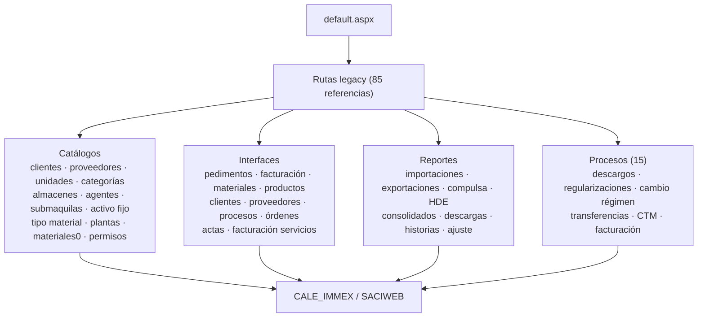

# Mapa de navegación

Fuente: DOM de `/Formularios/default.aspx`, perfil ADMINISTRADOR, 2026-10-20.

```mermaid
flowchart TD
    LOGIN["/Formularios/Login.aspx\n(SCR-001)"] --> HOME["default.aspx (SCR-002)"]
    HOME --> TOP["Top nav: Gestión"]
    TOP --> USR["catUsuarios.aspx (SCR-015)"]
    TOP --> ACT["catActividades.aspx (SCR-016)"]
    TOP --> PERF["Cat_Perfiles.aspx (SCR-017)"]
    TOP --> BIT["RptBitacoraA24.aspx (SCR-018)"]
    TOP --> SALIR["Salir() → Cerrar sesión"]

    HOME --> S1["I. Catálogos"]
    S1 --> DG["catDatosGeneralesA24.aspx (SCR-003)"]
    S1 --> MAT["catMaterialesA24.aspx (SCR-004)"]
    S1 --> PROD["catProductosA24.aspx (SCR-005)"]
    S1 --> EST["catEstructurasA24.aspx (SCR-006)"]

    HOME --> S2["II. Módulos"]
    S2 --> ENT["ModRptEntradasA24.aspx (SCR-007)"]
    S2 --> MU["ModInfMaterialesUA24.aspx (SCR-008)"]
    S2 --> SAL["ModRptSalidasA24.aspx (SCR-009)"]
    S2 --> AF["ModActivoFijoA24.aspx (SCR-010)"]

    HOME --> S3["III. Reporte de Aduanas"]
    S3 --> RE["RptEntradasA24.aspx (SCR-011)"]
    S3 --> RS["RptSalidasA24.aspx (SCR-012)"]
    S3 --> RD["RptSaldosA24.aspx (SCR-013)"]
    S3 --> RM["RptInfMaterialesUA24.aspx (SCR-014)"]

    HOME --> IFZ["Interfaces"]
    IFZ --> FACT["intFacturacion.aspx (SCR-019)"]

    HOME --> VAC["Secciones vacías (visible-false):\nB. Módulos de Captura · C. Descargas\nInformes · Informes Anexo 30\n(H-001)"]
```

## Rutas legacy accesibles por URL (fuera del menú)

**Riesgo:** las cuatro ramas son alcanzables con el perfil actual aunque no aparezcan en el menú (ERR-024-02). La rama de procesos incluye operaciones destructivas.

## Notas

- Rutas relativas al directorio `/Formularios/` salvo indicación (`../default.aspx` = home).
- Todas las pantallas del menú son links `<a href>` en el DOM (sin JS de navegación salvo `Salir()`).
- Relaciones entre pantallas (flujo de datos) se documentan en `procesos/flujos-funcionales.md` cuando haya evidencia de interacción.
