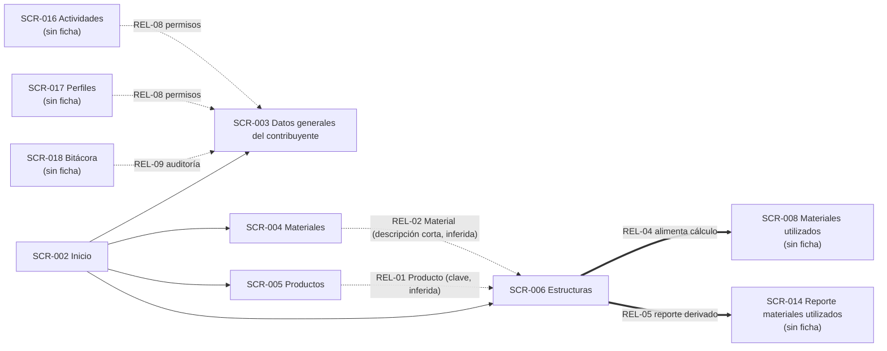

# Relaciones observadas entre pantallas y entidades — Auditoría E2E V2 (CALE Anexo 24)

- **Alcance:** relaciones extraídas de las fichas `pantallas/SCR-003.md` (Datos generales del contribuyente), `SCR-004.md` (Materiales), `SCR-005.md` (Productos), `SCR-006.md` (Estructuras) y del corte 2 de `seguimiento/avance.md`.
- **Consolidado:** 2026-10-20 · Perfil activo: ADMINISTRADOR · Empresa: PROCESADORA DE ALIMENTOS CALE (RFC [RFC omitido]).
- **Regla de la auditoría:** sólo se registran relaciones con evidencia en las fichas. Las que dependen de pantallas sin ficha (SCR-008, SCR-014, SCR-016, SCR-017, SCR-018) se marcan como **potenciales/inferidas**; no se verificaron ni se inventaron joins, cardinalidades ni claves no observadas.

## 1. Entidades observadas y su pantalla de origen

| Entidad observada | Pantalla origen | Atributos observados | Volumen observado | Certeza del volumen |
|---|---|---|---|---|
| Contribuyente (datos generales de empresa/IMMEX) | SCR-003 | Razón social, RFC, IMMEX, Domicilio fiscal | 1 registro | Confirmado |
| Material | SCR-004 | Fracción, Descripción, Unidad TIGIE, UMC, Número parte | 1128 registros / 113 páginas | Confirmado |
| Producto | SCR-005 | Fracción, Descripción, Unidad TIGIE, UMC, Número parte | 2632 registros / 264 páginas | Confirmado |
| Estructura (producto–material) | SCR-006 | Producto, Fecha vigencia, Material, Descripción, Unidad, Incorporado, Desperdicio, Merma | 5039 registros / 504 páginas (tras "Consultar") | Confirmado |
| Estructura – renglón de consumo | SCR-006 | Producto + Fecha vigencia + Material → Unidad, Cantidad incorporada, Desperdicio, Merma | Múltiples filas por producto/fecha | Confirmado |

**Clave compuesta propuesta para Estructura (en la ficha SCR-006, sección P):** producto + fechaVigencia + material. Es una propuesta de diseño, no un hecho verificado.

## 2. Relaciones pantalla ↔ entidad

| ID | Relación | Tipo | Evidencia | Certeza | Notas |
|---|---|---|---|---|---|
| REL-01 | SCR-006 Estructuras → Producto (SCR-005) | N:1 (renglón → producto) | Columna `col1 Producto` con valores 300770, 300771, 300772, 300774 | Inferido | La ficha indica "valores 300770… coinciden con formato de productos"; no se cruzó contra el catálogo de productos. Nota: el clave observado en Estructuras (6 dígitos) difiere del valor de la columna Fracción de Productos (8 dígitos, p. ej. 17049099), por lo que el tipo de clave no está determinado |
| REL-02 | SCR-006 Estructuras → Material (SCR-004) | N:1 (renglón → material) | Columna `col3 Material` con descripciones cortas: ACIDO LACTICO, AZUCAR ESTAN, TS8 | Inferido | Coincide en nombre/descripción con el catálogo de Materiales; no se verificó la correspondencia exacta de claves |
| REL-03 | Estructura → Producto ↔ Materiales (dentro de SCR-006) | N:N con atributo de vigencia | Filas 300771/01/08/2018 → AZUCAR ESTAN y TS8 (BR-006-01) | Confirmado | Un producto puede tener varios materiales en la misma fecha de vigencia |
| REL-04 | SCR-006 Estructuras → SCR-008 Materiales utilizados | 1:N (las estructuras alimentan el cálculo) | Sección N de SCR-006: "Las estructuras alimentan el cálculo de materiales utilizados"; flujo producto → estructura → consumo | Inferido | SCR-008 aún sin ficha en esta corte; relación tomada de la ficha SCR-006 |
| REL-05 | SCR-006 Estructuras → SCR-014 Reporte de materiales utilizados | 1:N (reporte derivado) | Sección N de SCR-006: "Reporte derivado de estructuras" (Módulo III.d) | Inferido | SCR-014 aún sin ficha en esta corte |
| REL-06 | SCR-002 Inicio → SCR-003/004/005/006 | Menú / navegación | Ruta de acceso "I. Catálogos > a) … b) … c) … d) …" en las cuatro fichas y en `01-inventario-pantallas.md` | Confirmado | Única navegación explícitamente documentada en estas fichas |
| REL-07 | SCR-003 Datos generales → contexto de sesión/empresa | 1:1 con la sesión activa | Encabezado: "Empresa CALE ([RFC omitido]), usuario ADMINISTRADOR"; fila única 1 registro | Confirmado | No se documentó llave por empresa/RFC en Materiales, Productos o Estructuras (ver huecos) |
| REL-08 | SCR-016 Actividades / SCR-017 Perfiles → visibilidad de Nuevo/Guardar en SCR-003 | Potencial (permisos) | Sección N de SCR-003: "control de visibilidad de btnNuevo/btnGuardar"; `btnNuevo`/`btnGuardar` `vis:false` | Inferido | H-001 abierto; sin ficha de SCR-016/SCR-017 en esta corte |
| REL-09 | SCR-018 Bitácora → cambios en datos generales del contribuyente | Potencial (auditoría) | Sección N de SCR-003: "cambios en datos generales podrían registrarse en bitácora" | Inferido | No verificado: la escritura nunca se ejecutó (ver BR-PEND-05) |
| REL-10 | Materiales (SCR-004) ↔ Productos (SCR-005) | Homología de esquema (no FK observada) | Mismas 5 columnas (Fracción, Descripción, Unidad TIGIE, UMC, Número parte) en ambos grids; `seguimiento/avance.md` (hallazgos corte 2) | Confirmado (esquema) / No verificable (vínculo de datos) | No se observó ningún campo que referencie de un catálogo al otro |

## 3. Diagrama de relaciones



```mermaid
erDiagram
  PRODUCTO ||--o{ ESTRUCTURA : "REL-01 producto"
  MATERIAL ||--o{ ESTRUCTURA : "REL-02 material"
  ESTRUCTURA {
    col1_producto "Producto"
    col2_fecha_vigencia "Fecha vigencia"
    col3_material "Material"
    col4_descripcion "Descripción"
    col5_unidad "Unidad"
    col6_incorporado "Incorporado"
    col7_desperdicio "Desperdicio"
    col8_merma "Merma"
  }
```

## 4. Modelos de entidad observados (atributos tal como aparecen)

```text
CONTRIBUYENTE (SCR-003, 1 registro)
  Razón social | RFC | IMMEX | Domicilio fiscal

MATERIAL (SCR-004, 1128)          PRODUCTO (SCR-005, 2632)
  Fracción | Descripción             Fracción | Descripción
  Unidad TIGIE | UMC | Número parte   Unidad TIGIE | UMC | Número parte

ESTRUCTURA (SCR-006, 5039)
  Producto | Fecha vigencia | Material | Descripción | Unidad
  Incorporado (6 dec) | Desperdicio (6 dec) | Merma (6 dec)
```

## 5. Huecos y límites de las relaciones observadas

- **Llave por contribuyente no documentada:** las fichas SCR-004/005/006 no muestran ningún campo que referencie RFC, IMMEX o empresa; no se puede afirmar que los catálogos estén particionados por contribuyente.
- **Tipo de clave de Producto no determinable:** los valores de `col1 Producto` en Estructuras (300770…) no coinciden con la columna Fracción observada en el catálogo de Productos (17049099). La correspondencia real está pendiente de verificación.
- **Correspondencia Material ↔ Estructura no verificada:** sólo se verificó coincidencia de descripción corta; no la clave.
- **SCR-008, SCR-014, SCR-016, SCR-017 y SCR-018** no tienen ficha en esta corte (`seguimiento/avance.md`); sus relaciones con SCR-003 y SCR-006 proceden de las secciones "N. Relaciones" de las fichas de catálogo, no de inspección propia de esas pantallas.
- **Sin escritura ejecutada:** ninguna relación de auditoría (REL-09) ni de persistencia pudo confirmarse en runtime.
- **No se documentaron** relaciones hacia SCR-007 (Módulo de entradas), SCR-009 (Salidas) y SCR-010 (Activo fijo) en las fichas leídas; no se infieren aquí.

## Fuentes

- `pantallas/SCR-003.md`, `pantallas/SCR-004.md`, `pantallas/SCR-005.md`, `pantallas/SCR-006.md` (secciones "E. Tabla de resultados", "M. Reglas de negocio", "N. Relaciones", "O. Evidencias").
- `seguimiento/avance.md` (corte 2 — 2026-10-20).
- `01-inventario-pantallas.md` (rutas de menú, para navegación).
