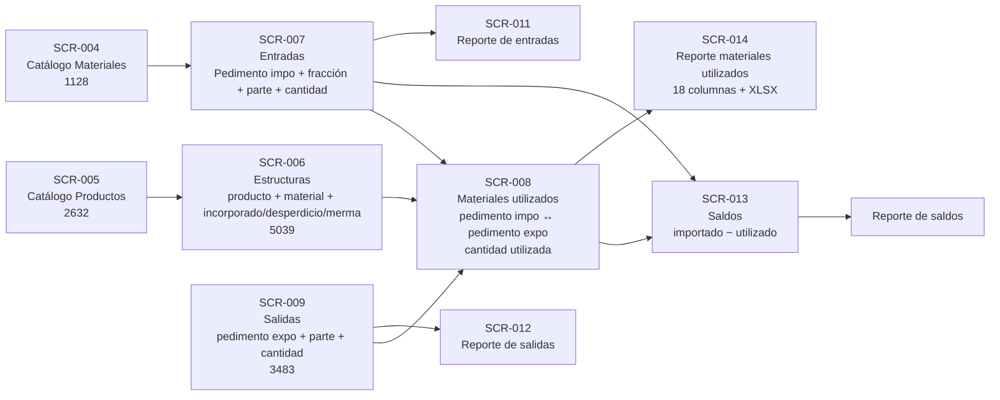
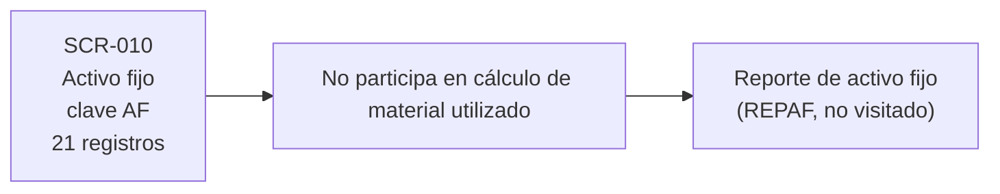
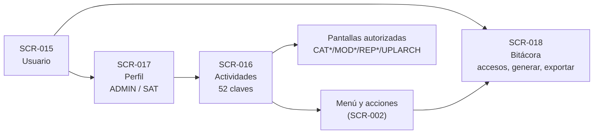
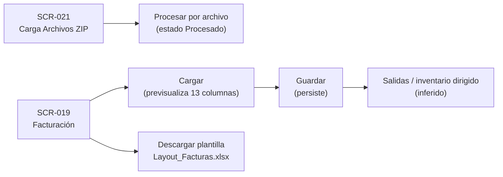

# Flujos funcionales

Diagramas construidos **solo** con evidencia de las fichas. Lo inferido se marca en el texto.

## Flujo de materiales (confirmado en UI, extremo a extremo)

**Reglas verificadas en el flujo:**
- Material utilizado = cantidad exportada × 1.2825 (muestra azúcar → producto 17049099).
- Saldo = importado − utilizado (1 500 000 − 191 929.6252 = 1 308 070.3748).
- Desperdicio/material ≈ 0.00396; merma/material ≈ 0.00594.
- Pedimento con formato `NNN-NNNN-NNNNNNN`; claves `V7` (entrada), `IN` (entrada), `RT` (salida), `AF` (activo fijo).

## Flujo de activo fijo (separado del consumo)

**Inferido:** el activo fijo no genera descargo por consumo (naturaleza IMMEX). No verificado en cálculos.

## Flujo de administración y permisos

**Confirmado:** el catálogo de actividades explica menús vacíos (H-001) y la visibilidad de acciones.
**No verificado:** asignación concreta actividad↔perfil (la UI de edición de perfil no abrió panel).

## Flujo de archivos

**Confirmado:** dos fases Cargar/Guardar; plantilla con 13 columnas (8 obligatorias).
**No ejecutado:** cargas reales (riesgo operativo).

## Flujo de un pedimento (trazabilidad)

Evidencia: el pedimento `190-3302-6001720` aparece en:
1. **SCR-007** Entradas (28/05/2026, azúcar refinada, 1 500 000 KG).
2. **SCR-008** Materiales utilizados (consumo en pedimentos expo 190-3302-6002233 y 190-3302-6002238).
3. **SCR-013** Saldos (1 308 070.3748 KG remanentes).

Esto demuestra trazabilidad extremo a extremo entre entrada, consumo y saldo para el mismo pedimento.
